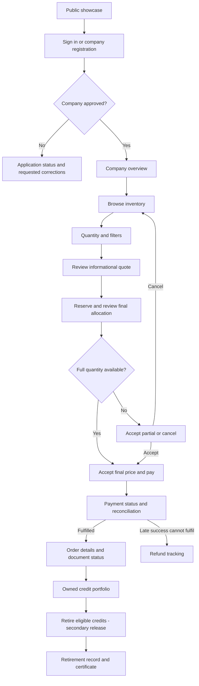

# Company buyer journey and screen design

Status: Draft product and implementation design, 2026-10-12. Expands corporate Flow F-C in [user flows](03-user-flows.md). Inherits [shared contracts](features/common-contracts.md), [design clarifications](features/design-issues.md) and the [public demo scope](13-public-demo-plan.md). Routes and company-account additions below are proposed, not implemented.

## 1. Goal and first release

A company sustainability officer can understand what is offered, create a purchase with a known quantity and price, complete payment, confirm ownership, and retrieve an auditable purchase record. Retirement is a separate action with its own certificate and reporting context.

The public demo uses a read-only showcase and a seeded, authenticated presenter buyer. Show a persistent “Demonstration — synthetic credits and simulated payments” banner. No real company identifiers, payment credentials or compliance claims are required. Company registration/approval screens may use seeded workflow states; self-service production onboarding is outside the critical demo path.

The production journey starts with company registration and approval. A target is optional: a buyer can buy without configuring a target. The target is a planning aid, not an emissions inventory, carbon-neutrality determination or compliance assessment.

## 2. Journey map

The browser's return from checkout leads to payment status, not directly to success. The server is authoritative for reservation, payment, ownership and retirement. A certificate job or chain proof can still be pending after a valid purchase completes.

## 3. Navigation and information architecture

| Destination | Purpose | Primary action |
|---|---|---|
| Overview | Next actions, holdings and recent activity | Browse credits |
| Marketplace | Eligible inventory and transparent price information | Review quantity |
| Orders | Reservations, payment outcomes, refunds and purchase documents | Open order |
| Portfolio | Owned, retired and affected credits | View provenance; retire if enabled |
| Documents | Purchase records, invoices/receipts and retirement certificates | Download |
| Company settings | Profile, application status and reporting targets | Save draft or submit |

Use one company context in the initial release. Cross-company membership switching is later scope and requires server-verified membership for every request. Order and portfolio ownership must attach to a stable company buyer account, not a contact phone or browser-selected company ID. The account/membership schema is an additive identity design task before production onboarding.

Team invitations, purchase approval budgets, enterprise SSO, automatic procurement, subscription purchases, reselling and automatic retirement are deferred. Do not display controls whose workflows do not exist.

## 4. Screen-by-screen contract

### C01 Public showcase and sign-in

Explain the supply type, provenance available, purchase process and demo status. Public visitors can inspect sample inventory and a sample certificate. “View demo” stays read-only; “Presenter sign-in” opens authenticated interaction. Production has a separate “Register company” entry.

Sign-in inherits secure sessions and OTP handling. Redirect only to allowlisted internal destinations. Preserve a nonbinding inventory selection after sign-in, then obtain a fresh quote. Public browsing does not grant order, private document or presenter-control access.

### C02 Company registration and approval

Draft fields: legal/display name, company contact, registered/billing address and applicable registration identifiers. GSTIN/CIN validation and mandatory-field rules require a confirmed company policy; do not infer that both apply to every organisation. Verify representative contact; company approval is a separate institution/platform workflow, not proof that any staff member can approve any company.

Proposed application states: DRAFT → SUBMITTED → APPROVED, or NEEDS_INFORMATION / REJECTED. Show submitted date, current state, permitted corrections and a support reference. Only approved accounts can reserve or pay. Application status remains accessible to its applicant while purchase actions are blocked. Approval of a seeded demo company is explicitly simulated.

Edits to verified identity/registration fields require review and may suspend new purchases according to an explicit policy. Existing orders, refunds and lawful document access must not disappear during review. Avoid public lookup endpoints that reveal company applications or contacts.

### C03 Company overview and optional target

Show four distinct values: purchased quantity, currently eligible owned/unretired quantity, retired quantity, and credits with an active dispute/reversal notice. Display the reporting period and update time; historical purchased totals must not be mistaken for current valid holdings. Refund totals and payment-pending amounts are separate monetary summaries.

Primary action: “Browse credits”. Next actions identify active reservations, payment reconciliation, pending documents and unresolved notices. Empty state explains the first purchase rather than showing fabricated impact data.

A target has quantity, unit and reporting-period boundaries. Show “Retired for this period / target” only when retirement and reporting attribution are implemented. For the core demo, use “Purchased quantity” with separate target context; avoid a “carbon neutral” badge or automatic percentage of verified emissions offset.

### C04 Marketplace

Filters: supported credit type, vintage and geography. Clarify that geography is project location; vintage is credit production period; reporting period is chosen separately on retirement. One order supports one credit type. Start with aggregate cards rather than a farmer directory.

Cards show eligible quantity, price or resolved price range, units/currency, vintage/geography, methodology/version summary, verification basis and read freshness. A detail panel explains available provenance, confidence/buffer treatment and applicable limitations using approved descriptions. No private farmer contact, bank details, exact polygon or raw evidence is exposed.

Quantity input uses the registry's supported whole-credit units. Display tCO2e explicitly and reject decimals when fractional credits are not supported. A budget estimate is informational. “Review quantity” fetches a quote; it does not reserve stock. No ordering by individual farmer or reliability tier: FCAE controls allocation.

### C05 Quote review and reservation

Show requested quantity, filters, estimated total, applicable published tax lines, quote version/expiry and a clear “Reserve and review” action. Missing price/tax coverage blocks checkout with a useful explanation; it is not treated as zero tax. Demo tax lines say they are simulated.

On reservation, show final allocated quantity, shortfall, total, valid price snapshot, reservation deadline and aggregate allocation summary. Use “verified payee groups” when that is what the algorithm counts; do not label it a number of farmers without a distinct verified count. Explain fair allocation in plain language without exposing private scores or tuning parameters.

If shortfall occurs, present “Accept X credits for ₹Y” and “Cancel reservation”. Never charge for the originally requested quantity when fewer are allocated. Zero allocation returns to selection with a reason. Supply, allocation cap and reservation quota are distinct explanations; do not silently weaken a rule. Changing quantity/filters cancels the old reservation before placing a new one; unknown cancellation results are reconciled before another reservation is attempted.

If final price differs from the quote, require explicit acceptance. Payment references the accepted snapshot, not a client-submitted amount. Show the server expiry time plus an approximate countdown. Countdown zero triggers a status refresh; it does not independently change the order or justify a new payment.

### C06 Checkout and payment status

Checkout shows company billing summary, final quantity, immutable payable total, order reference and reservation deadline. “Pay ₹Y” creates one durable payment attempt with a stable request key. Disable repeat submission during the request, but server idempotency remains mandatory. The demo button says “Simulate payment”; advanced failure controls are presenter-only.

After return or refresh, retrieve the existing attempt/order. Display “Confirming payment” while confirmation is uncertain. Explain that closing/reopening the page preserves the order. Poll with bounded backoff only while visible and pending; stop on final state and offer manual refresh. Never request another payment solely because a callback has not arrived.

| Situation | Buyer message/action | Server rule |
|---|---|---|
| Confirmed fulfilment | “Purchase complete”; open order | SOLD and accounting commit together |
| Confirmed failed attempt, reservation still valid | “Payment failed”; retry if the server permits | Recheck ownership/deadline and unresolved attempts |
| Provider outcome unknown | “Checking payment”; view status/support reference | Reconcile existing attempt before another intent |
| Expired reservation, no unresolved payment | “Reservation expired”; review a fresh order | Old price/availability are not guaranteed |
| Late success under revalidation | “Payment received; checking original allocation” | Same credits, all-or-nothing |
| Late success cannot fulfil | “Full refund pending”; track refund | No silent substitute or partial fulfilment |
| Duplicate successful payment | “Purchase complete; extra payment refund pending” | Order stays fulfilled; separate refund record |

Cancellation while payment is unresolved is a request to cancel the reservation, not a promise that no charge can arrive. Its confirmation explains that a late confirmation is rechecked and may lead to fulfilment or refund. Keep refund reason, amount, provider status and last checked time visible; do not promise an unconfirmed refund date.

### C07 Order details and documents

Stable order URL survives reload and notifications. Show quantity requested/fulfilled, immutable price/tax breakdown, order state, payment attempts/refunds, billing snapshot, aggregate allocation, time-stamped activity and available documents. Purchase is complete only on server-confirmed FULFILLED; no standalone committed PAID screen is required by the atomic contract.

Purchase certificate status: Preparing / Ready / Needs attention. A renderer outage leaves the order fulfilled with a recoverable document status. Chain proof status is separate and does not block download. Invoice, payment receipt, purchase certificate and retirement certificate have distinct names and purposes. The demo certificate prominently states synthetic/demo status.

Downloads recheck company ownership and issue expiring private links. Public certificate verification is a separate minimal view with token, document hash and current notices. Link expiry offers a fresh authorised download; it does not ask users to repeat payment.

### C08 Portfolio and retirement

Portfolio rows aggregate type/vintage/geography, quantity, purchase origin and current eligibility/notice state. Detail exposes approved pseudonymous provenance and document links. Pagination and server filters bound work; do not download the entire registry into the browser.

Secondary retirement flow: select owned eligible quantity → preview exact credit selection → choose reporting period and purpose → review irreversible effect → confirm → retirement record → certificate pending/ready. Quantity-based selection requires a deterministic server preview whose explicit references are checked again on commit; the client must not invent credit IDs. Frozen, already retired, reversed or unowned credits are rejected with an updated preview.

Mixed reporting periods must not be assigned to the same retired credit. RETIRED is terminal; later adverse findings appear as notices/replacement history. Purchase alone is not retirement. Keep partial retirement and reporting export hidden until implemented; core demo can finish at purchase certificate download.

### C09 Notices and support

Notifications link to authorised order/credit/case detail. Explain affected quantity, current action and reviewed remedy without asserting an unapproved refund/replacement policy. A buyer can submit evidence for its own purchase through a scoped case form; multiple active cases must not accidentally clear another case's hold.

Support requests include an order/case reference and safe explanatory text, never OTP/card/bank secrets. Support contact/channel is configured for the deployment; avoid a dead button or invented service SLA.

## 5. UI-to-module contracts

| UI operation | Application owner/contract | Important boundary |
|---|---|---|
| Sign-in, company profile/application | identity; proposed company approval use cases | Session and verified company membership |
| Target save | proposed company-planning owner within identity initially | No effect on issuance, ownership or MRV |
| Browse/quote | market + pricing read/use cases | Freshness and nonbinding quote |
| Reserve/accept/cancel | market commands in [F9](features/09-orders-fcae.md) | Atomic allocation, quota, expiry, ownership |
| Pay/track/refund | payments in [F10](features/10-payments-refunds.md) | Durable attempt, reconciled outcome |
| Order/document views | market, invoicing, certificates read ports | Immutable snapshots and resource access |
| Portfolio/retire | registry + market ownership ports | Exact refs and terminal retirement |
| Notices/cases | disputes + notify read/command ports | Company scope and reviewed remedy |

Frontend routes may be `/company/overview`, `/company/marketplace`, `/company/orders/:id`, `/company/portfolio`, `/company/documents` and `/company/settings`. Existing proposed backend routes remain under `/api/v1`; new profile/target routes require owned schema and actor/object policy before implementation. A company dashboard is a bounded read composition, not a new service with write access to every module.

## 6. Security, performance and accessibility

Every detail/list/export/payment/retirement query checks company buyer membership and demo scenario. Route hiding, possession of an order ID and company registration approval are insufficient authorisation. Billing/contacts stay private. Apply session, CSRF, rate-limit and idempotency requirements from the shared contracts. Never persist payment success or tokens in localStorage as authority.

Company purchase actions require connectivity. Draft filters and non-sensitive UI choices may survive reload; monetary/ownership actions do not queue for offline execution. On session expiry, sign in and resume the existing order, then recheck reservation and snapshot. On 503, retain request identity and resolve unknown outcomes before retrying a mutation.

Use capped cursor lists, aggregate projections with freshness, bounded detail manifests, asynchronous exports and document rendering. Poll pending records with jitter/backoff; browsing/overview must not hold allocation locks. Display stale reads honestly and refresh from the primary for checkout. Measure route latency, pending-payment age, lock wait, refund age and document lag without person/company-ID metric labels.

Keyboard navigation, accessible field errors and status announcements, currency/quantity formatting and mobile layouts apply throughout. Do not communicate success/failure through colour alone. Deadline/payment status must be readable without animated countdowns; status changes must not repeatedly steal focus.

## 7. Demo slice and acceptance

Build C01 seeded sign-in → C03 overview → C04 inventory → C05 reserve/final review → C06 simulated payment → C07 purchase/document → C08 read-only holdings. Public viewers can inspect a separate completed sample. Company onboarding review, retirement, team purchasing and reporting export are secondary.

Checks before calling the flow complete:

1. Fresh seeded buyer buys 20 credits from the documented 20-group scenario; quantity, payment, ownership and document reconcile.
2. A shortfall requires explicit acceptance and correct revised charge; a changed price requires new acceptance.
3. Concurrent buyers never obtain the same credit; quota/cap shortfall remains intelligible.
4. Double-click, reload and repeated callback produce one order effect/earning; duplicate successful attempts show a separate refund.
5. Gateway return without trusted confirmation stays pending. Unknown outcomes suppress unsafe repeat payment.
6. Expiry, cancellation and late success end in correctly reconciled fulfilment or full refund; the UI never invents ownership.
7. Document failure leaves purchase complete; retry/download does not duplicate certificates or payment.
8. A second company and public viewer cannot read private order, billing, document or portfolio records, even by direct API/guessed ID.
9. Presenter reset fences old jobs; a stale page refreshes instead of mutating reseeded data.
10. Secondary retirement checks exact ownership, freeze and duplicate requests; the dashboard distinguishes purchased from retired quantities.

Open decisions: mandatory company identifiers and approver mandate; multi-user procurement approvals; required billing/target fields; supported reporting exports; live refund/support policy. None needs to block the seeded purchase demo, but production onboarding and unsupported compliance claims cannot be inferred from it.
