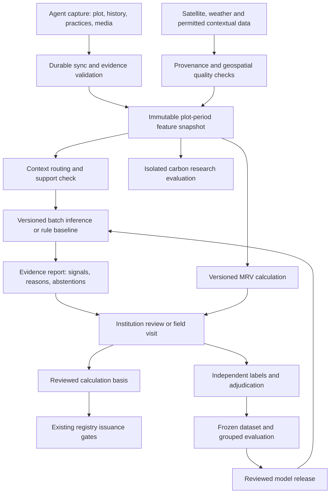

# 15 · ML workflow: India-wide design, demo to field pilot

Date: 2026-10-12. Status: proposed design; no models trained or application implemented. Scope confirmed by the project owner: both public demo and field pilot, with broad coverage across India. Complements [MRV design](08-mrv-module-design.md), [evidence review](research/mrv-evidence-review.md), [verification](features/05-verification.md) and [demo plan](13-public-demo-plan.md).

## 1. Product decision

2026-10-13 data collection update: [candidate datasets](../data/ml/README.md) now include curated West Bengal management/yield survey rows and local rice-gas study extracts, with national/global comparison subsets. These do not supply independent practice-verification images or paired SOC stock changes. No model trained, split frozen or production release approved.

Build a shared national evidence pipeline with context-specific validation and explicit abstention. Start ML with evidence interpretation and review prioritisation. Keep carbon accounting in the versioned MRV methodology; evaluate learned carbon estimates separately before proposing any crediting use.

India-wide data capture is an architectural goal. India-wide predictive validity must be earned context by context. A supported context is a versioned combination of agro-ecological region, crop/rotation, season, soil, irrigation and practice bundle, with recorded evidence and validation boundaries.

The current `area × factors × NDVI_multiplier` is an experimental methodology, not a trained ML model. Its multiplier remains an unvalidated assumption. This design proposes comparing practice-only and satellite-assisted approaches; it does not approve or silently replace the formula in doc 08. Its statement that NDVI proves practice adoption also needs narrowing: greenness is contextual evidence and does not establish every claimed practice. Any scientific wording or production methodology change requires a separately reviewed revision.

## 2. National coverage strategy

Use ICAR-NBSS&LUP agro-ecological regions as a candidate geographic stratification, then refine by actual plot conditions. ICAR describes 20 regions based on soils, physiography, bioclimate and growing period; states alone are too coarse for the proposed model routing. [ICAR source](https://epubs.icar.org.in/index.php/AAZ/article/view/63327).

Define broad reach through three separate measures: eligible cultivated hectares, eligible farmer households and share of priority contexts with independently validated support. Do not count accepting a plot in the UI as validated ML coverage. Resolve whether land area or farmer reach is the primary optimisation objective before selecting sites.

Build a coverage matrix from official crop-area statistics, partner availability and a dataset audit. Use [Agricultural Statistics at a Glance](https://desagri.gov.in/document-report-category/agriculture-statistics-at-a-glance/) as a starting source; record edition, reporting year and table identity. No national ranking or coverage percentage has been calculated yet. Crop-season areas are not unique physical hectares, and crop-area tables do not directly count unique households: deduplicate rotations and use an appropriate household source before claiming reach.

Candidate context families below are planning hypotheses, not validated support or a ranking:

| Family | Candidate practices to investigate | Required distinction |
|---|---|---|
| Irrigated rice and rice-based rotations | Water management, residue management, reduced tillage in rotation | Methane, SOC and N2O effects; observation of vegetation does not prove irrigation schedule |
| Wheat-based rotations | Tillage and residue bundles, nutrient management | Annual rotation versus individual crop factors |
| Rainfed cereals, millets and maize systems | Soil cover, residue retention, reduced tillage | Rainfall variability, sparse canopy and soil differences |
| Pulses, oilseeds and cotton systems | Rotation diversity, cover and input management | Crop-specific signals, bundled effects and input records |
| Perennial and agroforestry systems | Tree establishment and management | Separate biomass/permanence methodology; later scope, consistent with deferred LTCC/TPC |

Prioritise a small set of representative contexts using area/reach, plausible eligible practices, independent measurements, partner capacity and cost. Reserve held-out sites before training. Expand with one reviewed context release at a time; do not deploy separate models for every matrix cell when labels are insufficient. Compare a pooled model, a pooled model with context features and local models where enough data exists.

## 3. ML responsibilities and boundaries

| Task | Initial baseline / candidate | Ground truth | Output and permitted use |
|---|---|---|---|
| Media and record quality | Required fields, decode checks, exact duplicates; later learned blur/content checks | Independently annotated usable/unusable evidence | Reason-coded recapture suggestion; does not approve adoption |
| Crop/season consistency | Declared calendar and seasonal features; compare simple classifier and tree ensemble | Independent field crop and date records | Consistency signal or abstention for reviewer |
| Practice evidence support | Practice-specific rules; classifier only for observably supported tasks | Dated independent visits with confirmed/contradicted/unknown labels | Support/contradiction/unknown per practice; no universal adoption score |
| Review prioritisation | Explicit queue rules; later calibrated classifier | Adjudicated outcomes and random audit sample | Suggested review priority; no automatic rejection, payout penalty or FRPS change |
| Carbon estimation research | Context-matched published baseline; compare regression candidates | Paired SOC stocks and management/control data; separate other GHG evidence | Research estimate and uncertainty, isolated from issuance |

Train classifiers only when labels support their intended claim. Missing labels remain unknown; they are not negative examples. Use rules when training evidence is insufficient. A synthetic classifier can demonstrate plumbing but cannot demonstrate real-world accuracy.

FCAE, prices, eligibility policy, buffers, verification decisions, issuance and payouts stay with their current modules. ML has no financial write ports. Do not train a model to imitate placeholder carbon calculations and call the resulting accuracy carbon validation.

## 4. End-to-end flow

For the demo, the same flow uses labelled synthetic scenarios in a separate namespace. Production-origin checks and registry restrictions remain intact. Carbon research outputs have no path to registry issuance. Evidence feedback enters a future dataset release, never an automatic online update of the active model.

## 5. Data and feature contract

The evidence prediction unit is one `plot × crop cycle × evidence cutoff`. The carbon research unit is a plot monitoring interval, possibly spanning several crop cycles. Store both explicitly rather than forcing annual SOC change into a crop-cycle label.

Required capture fields: pseudonymous plot/cycle IDs, versioned geometry and area, crop/rotation, planting/harvest dates with uncertainty, irrigation type, claimed practice dates, baseline management history, available soil information, evidence slot IDs, capture/server timestamps and time-integrity flags. Separate claimed, independently observed and unknown values.

Each input records source, licence/allowed use, acquisition and availability times, units, spatial/temporal resolution, processing version, quality flags and content hash. Keep identities, bank data, exact polygons and private media out of general research exports. Access to precise spatial inputs is scoped to the processing task. Consent and erasure obligations apply to training copies and label stores, not just the transactional app.

Satellite processing starts with cached, provenance-controlled exports, consistent with the existing stack. Compute plot-level valid-pixel counts and fractions; mask clouds/shadows using a versioned policy; retain missingness. Sentinel-2 bands have different native resolutions and its scene classification layer is produced at 20 m. Align grids deliberately; resampling does not create finer ground information. [Copernicus mission](https://sentiwiki.copernicus.eu/web/s2-mission), [processing](https://sentiwiki.copernicus.eu/web/s2-processing).

Candidate features: NDVI seasonal median/peak/integral and observed trend; observation counts, longest gap and interpolation share; red-edge/SWIR summaries where justified; crop dates, rainfall/temperature summaries, irrigation and baseline practice history. Features are candidates to test, not established causal measures. Rainfall and soil products must pass source/licence and applicability review before ingestion.

Small or narrow plots with too few uncontaminated pixels require abstention or field evidence. Set minimum pixel/coverage and gap rules during pilot protocol review. Do not extrapolate interpolated periods across long monsoon gaps. Sensor fallbacks must record sensor and harmonisation version; do not treat Sentinel-2, Landsat and Bhuvan as interchangeable numerical sources without assessment.

Every snapshot pins input IDs, geometry version, cutoff, context version, feature schema and transform code. Only data available by the inference cutoff may enter operational features. Final lab outcomes, later verification, future imagery and future FRPS cannot leak into prediction inputs.

## 6. Ground truth and labelling

Evidence labels come from structured independent visits/records, with observer, date, practice definition, uncertainty, supporting references and adjudication. Keep capture agent and approving reviewer separation. Reviewer impressions influenced by a displayed ML score are not automatically independent truth; record whether the score was visible.

Review a random or stratified sample in addition to high-risk cases. Log selection probabilities where feasible so evaluation can account for audit selection. Otherwise the dataset will disproportionately represent suspicious cases and miss false negatives. Include disagreements and unresolved outcomes rather than removing difficult cases.

Carbon labels require baseline/follow-up SOC measurements, bulk density, depth, coarse-fragment information where relevant, sampling design, laboratory methods, uncertainty and management/control histories. Have a soil specialist determine fixed-depth/equivalent-soil-mass treatment and monitoring intervals. SOC concentration alone is not SOC stock change. Short demo or pilot windows cannot be assumed to produce measurable annual stock changes.

Keep SOC removals, methane, nitrous oxide and fuel emissions as separately defined components. A treatment-control stock difference is not by itself crediting additionality; baseline, leakage and permanence still need methodology review. The [IPCC agriculture/land-use guidance](https://www.ipcc-nggip.iges.or.jp/public/2019rf/vol4.html) is a reference framework, not automatic approval of project credits. Existing published benchmark reproduction remains arithmetic evidence only.

Determine site/plot counts through a sampling and power plan using observed variance, cluster dependence and target error. Do not promise a universal minimum number of rows or accuracy target before the dataset audit.

## 7. Offline training and evaluation

1. Register a permitted dataset snapshot; audit labels, units, duplicate media, geometry overlap, context balance and monitoring periods.
2. Freeze a split manifest. Keep repeated observations, duplicates and related plots within the same group. Use site/village groups where dependence warrants it; reserve a later season and external sites for separate transfer tests.
3. Fit all imputation, encoding, feature selection and model tuning within training folds. Use grouped validation, then calibration/threshold selection on data separate from final testing. These leakage controls follow [scikit-learn pipeline guidance](https://scikit-learn.org/1.9/common_pitfalls.html) and [GroupKFold](https://sklearn.org/stable/modules/generated/sklearn.model_selection.GroupKFold.html).
4. Compare rules/simple models against tree-based candidates. Deep learning is a later candidate requiring a justified image/time-series dataset; it is not required for the demo.
5. Evaluate once on the frozen test set; report context-level counts, errors and uncertainty. A failed test needs a new development cycle and fresh holdout, not repeated tuning against that test.
6. Package model, preprocessing, support map, thresholds and model card as one immutable release. Publish only after technical and domain review.

Evidence metrics: precision/recall per class, confusion matrix, calibrated probability checks, abstention/coverage, false-flag burden and review yield at an explicit visit budget. Report by crop, region, season, plot size and irrigation where counts permit. Keep end-to-end reviewer workload and decisions separate from pure model accuracy.

Carbon metrics: signed bias, MAE/RMSE and interval coverage/width, with explicit units and interval duration. Evaluate stock change first; any annualisation must be documented. Compare practice-only versus satellite-assisted models on identical holdouts, plus ablations of NDVI and context inputs. Report errors on negative/zero changes too; clamping before evaluation would hide overestimation.

Pre-register release thresholds, acceptable subgroup errors and minimum evidence for context support with domain reviewers. Predictive uncertainty, data-quality scores, class probability and permanence buffer are four distinct quantities; none substitutes for another.

## 8. Runtime integration and persistence

Keep the Node/TypeScript modular monolith and PostgreSQL source of truth. Use an isolated Python batch process for training and, when needed, geospatial inference. Initially import schema-validated batch artifacts through an application port; add a Python inference worker only when a real model requires it. No always-on model service, online feature store or GPU dependency is required for the demo.

Proposed ownership: `ml_evidence` owns snapshots, model metadata and evidence predictions; `verification` owns adjudication; `mrv` owns carbon calculations. External workers receive scoped immutable input artifacts and return results through an authenticated import path, without direct writes to other modules. Queue CPU-heavy work separately from finance and MRV jobs.

Proposed records, subject to migrations and access review:

- `ml_feature_snapshots`: plot/cycle or monitoring interval, namespace, cutoff, geometry/context/schema versions, input IDs and hash, artifact reference, quality flags.
- `ml_label_versions`: target, observed interval, value/unknown, independent source, observer/adjudication, uncertainty, policy version and allowed use.
- `ml_dataset_versions`: snapshot/label IDs, exclusions, split manifest, source licences and content hash.
- `ml_model_versions`: task, training dataset/split, code/environment/artifact hashes, feature contract, thresholds, support map, model card, evaluation and reviewer identities.
- `ml_inference_runs`: unique effect key `(namespace, task, snapshot_hash, model_version)`, outcome, duration/error and output reference.
- `ml_predictions`: immutable task result, version references, reasons, calibrated score/interval where valid, abstention and support status.

Lifecycle: `QUEUED → RUNNING → SUCCEEDED | ABSTAINED | REJECTED_PROVENANCE | FAILED`. Retry transient failures with a bounded policy; duplicate delivery must persist one result. Abstention and no prediction are explicit outcomes, not zero risk or zero carbon. Reject mismatched feature schemas, unsigned/unapproved releases, wrong namespaces and invalid output ranges.

Inference runs outside long DB locks. At commit, compare the current evidence/geometry generation to the pinned snapshot; stale outputs may remain historical but cannot become the current review report. Each review pins the evidence report ID and calculation ID. An updated advisory report invalidates its review snapshot but does not itself recalculate carbon; MRV input changes follow the existing recalculation path. No automatic revision to issued credits.

The reviewer sees support status, data gaps, evidence dates, model/rule version, task-specific reasons and abstention. A displayed class probability must describe its target rather than appear as generic carbon confidence. ML outage leaves an explicit unavailable signal and routes to the approved manual workflow; it cannot silently bypass required evidence.

## 9. Promotion, monitoring and retraining

Release progression: `DRAFT → EVALUATED → SHADOW → APPROVED_ADVISORY → RETIRED`. Start field inference in shadow mode; results do not change queue order until reviewed evaluation passes. Scientific crediting integration is a separate methodology decision, beyond advisory promotion.

Monitor missingness, valid-pixel coverage, input/context drift, unsupported-context and abstention rates, inference latency/failures, queue age, calibration and observed errors when delayed labels arrive. Report regional review burden and random-audit coverage. Input drift is a prompt to investigate, not proof of performance loss.

Retrain after reviewed data releases, material source changes or measured degradation. Keep the current release until the challenger passes frozen evaluation; never automatically train and promote from new verifier decisions. Rollback selects a prior compatible model for new inference; old predictions and reviewed calculations remain traceable. A new context requires transfer evidence even if national aggregate scores improve.

## 10. Delivery stages and exit gates

| Stage | Deliverable | Exit gate |
|---|---|---|
| Demo, aligned to existing 4–8 week product window | Synthetic contexts, deterministic quality/support rules, versioned reports, abstention and review screens | Seeded scenarios replay; fixtures isolated; stale reports and duplicate imports handled; no real-accuracy claim |
| Dataset and coverage audit | National matrix, permitted sources, partners, target definitions and split/sampling protocol | Primary reach objective chosen; accessible independent labels verified; pilot contexts selected |
| Multi-context pilot | Consented capture, independent visits, soil protocol, cached satellite extraction and baseline reports | Source/label quality established; support boundaries explicit; no assumed SOC validation from a short season |
| Shadow models | Frozen grouped/temporal/external evaluation against simple baselines | Predefined task/context gates met; review burden acceptable; domain review recorded |
| Advisory rollout | Approved evidence models and monitored manual fallback | Versioned release and rollback verified; random audit feedback continues |
| Carbon research and possible integration | Paired independent measurements, net-GHG boundary, uncertainty and methodology review | Separate scientific/eligibility approval; production methodology revised explicitly before any issuance use |

The ML-specific demo can be built with rules; training should not block the core farmer-to-buyer demonstration. Field measurement and carbon-validation timelines are separate from the demo deadline.

Meaningful implementation checks: no train/test group or time leakage; transformations fitted only on training data; inference/training features agree; unknown labels stay unknown; incompatible contexts abstain; fixture/provenance/schema rejection; duplicate/crashed imports remain idempotent; changed geometry/evidence invalidates current reports; model rollback retains history; ML roles cannot issue credits or alter money.

## 11. Decisions still needed

1. Primary national reach objective: cultivated hectares or farmer households; define the reporting denominator and priority contexts.
2. Accessible datasets and field partners: inventory actual labels, licences and paired SOC records before model selection.
3. First supported targets and context subset: choose independently observable practices and representative sites from the coverage audit.
4. Named domain reviewers, soil-sampling protocol, uncertainty method and pre-registered task-specific acceptance thresholds.
5. Research/training budget and permitted compute/storage environment. Library versions will be pinned at implementation, not assumed from the older application stack draft.

Immediate next design artifact: a national coverage/data inventory with one row per candidate context, its area/reach source, target definition, available independent labels, satellite constraints and pilot partner. That inventory determines the first training dataset and supported tasks.
