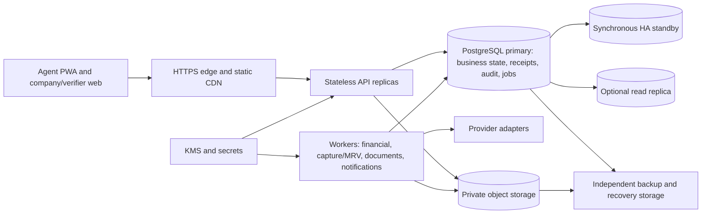

# GreenChain system design: consistency, scale and recovery

Status: Proposed implementation baseline, 2026-10-12. This document consolidates the [architecture](10-architecture.md), [feature contracts](features/README.md) and [company journey](14-company-buyer-flow.md). Engineering corrections stated here supersede conflicting draft paragraphs in earlier documents. Scientific parameters, legal policy, replacement commission treatment and production approval remain open. This is a design, not a measured capacity or availability guarantee.

## 1. Architecture and sources of truth

Use a TypeScript modular monolith with independently deployed API and worker process types. The initial public demo uses the Fastify default already specified in doc 13. Business rules depend on application ports, not Fastify, SQL drivers, cloud SDKs or vendor responses. One primary PostgreSQL/PostGIS database commits authoritative changes. Static PWA assets use a CDN; private evidence and generated documents use object storage. Redis, a broker and microservices are not dependencies of the initial release.



| Information | Authority | Consistency contract |
|---|---|---|
| Offline field drafts | Device IndexedDB until acknowledged | Local durability only; server acceptance is separate |
| Accepted evidence/rights/calculation basis | Primary database, with validated object references | Versioned facts and explicit review; no replica-based issuance |
| Credit ownership, reservations, sales, retirements | Primary registry and market records | Transactional checks and unique ownership |
| Earnings/journal/payable/payout claims | Primary ledger and payouts | Atomic internal postings; external settlement reconciled |
| Provider settlement | Provider evidence matched to durable intent | Uncertainty is persisted, not inferred from browser return |
| Inventory, tier and dashboard displays | Owner-maintained aggregates/projections | Freshness visible; critical commands recheck authoritative state |
| PDF/chain proof | Derived artefact with immutable snapshot/hash | Does not determine ownership or payment completion |

Choose consistency over availability for financial/credit writes: on primary uncertainty, stop the operation with a retryable response and preserve request identity. Field capture can continue locally. A synchronous standby is not a second writer. Prevent split brain through hosting failover/fencing, rather than making clients select whichever database answers first.

## 2. Ownership and clean architecture

Module owners remain those in doc 10: identity, land, capture, MRV, verification, registry, FRPS, market, pricing, payments, ledger, payouts, invoicing, certificates, disputes, notifications, audit and chain. Infrastructure kernel owns jobs/receipts, not business policy. Admin composes approved read ports and named commands; it cannot edit arbitrary tables.

Within each module: `domain` holds pure value objects/rules; `application` holds use cases and port interfaces; `infra` implements persistence/providers; `http` maps validated requests and errors. Enforce import boundaries in CI. Use module schemas or explicit ownership conventions, migrations owned by the module, and restricted worker DB roles. The API role may require multiple owners' writes for atomic workflows; this is not database-level isolation between modules.

Cross-owner transactions are application workflows wired by the composition root. A passed transaction handle cannot be committed by a participating port. Pass immutable values between ports; do not expose repositories or add reciprocal module imports. In particular, fulfilment obtains its order/commission snapshot from market and supplies it to ledger. Remove the old ledger → market synchronous dependency for fulfilment. Independent after-commit consumers use events.

Company buyer accounts and memberships are identity-owned additions. Private company data scopes by buyer account; field evidence scopes by institutional assignment/mandate. Marketplace publication is deliberately cross-institution but anonymised. Demo scenario/generation is an additional boundary, never a substitute for actor/object permission.

## 3. Invariants and database enforcement

| Invariant | Required enforcement |
|---|---|
| A credit cannot belong to two active orders | Unique active credit reference; registry guarded transitions under locks |
| Fulfilment cannot sell another order's reservation | Recheck exact active item and `reserved_order_id` under credit lock |
| A payment event/effect cannot apply twice | Provider/environment event uniqueness plus business effect keys |
| A fulfilment produces one earning and balanced journal | Unique EARN key per order item; deferred balance validation; same commit |
| A lot cannot fund two active payouts | Unique active lot claim under payee lock |
| Issuance uses one active reviewed basis | Cycle state pointer/generation, exact basis reference and issuance receipt |
| Retired credits cannot be resold | Allowed-transition guard; adverse findings recorded as notices/history |
| A projection cannot reset farmer waiting time on expiry | Preserve original `available_since`; ageing changes on fulfilment only |
| Financial corrections retain history | Append compensating records; restricted update/delete grants |
| No job crosses a demo reset | Scenario/generation references and transactional write fence |

Use integer paise and exact fixed-scale methodology decimals; never floating-point money. Foreign keys and references carry vintage when credits are partitioned. Start unpartitioned unless measured index/maintenance pressure justifies partitioning; the API already carries `{creditId,vintageYear}`. Production uniqueness must survive partitioning, not be weakened to accommodate it.

Aggregate eligibility counts are synchronous core state, updated with registry mutations; they are not eventually consistent marketing counters. FRPS tiers can be projected, but every allocation records projection sequence, policy version and tier/commission snapshots. Replaying an allocation uses those values, not current scores.

## 4. Isolation, locks and command protocol

Default guarded workflows use READ COMMITTED with explicit locks and constraints. Queries with predicate invariants require an explicit serialisation protocol or SERIALIZABLE plus whole-transaction retry. In particular, near-overlap plot detection cannot be made safe by an unlocked “check then insert”. Use a reviewed spatial-cell locking protocol or an indexed SERIALIZABLE implementation with concurrent tests before shipping it. [PostgreSQL isolation documentation](https://www.postgresql.org/docs/16/transaction-iso.html) explains snapshot differences and transaction retries.

Every workflow determines its complete lock plan before acquiring business locks. Acquire only the needed subsequence in this global order:

1. Demo scenario shared write fence; request receipt claim; applicable authorisation/consent guard rows if the command must serialise with revocation.
2. Buyer-limit rows, sorted, where global buyer quotas can change.
3. Credit-type advisory locks, sorted, scoped by environment/scenario.
4. MRV/verification cycle locks, sorted, when a reviewed basis/issuance is touched.
5. Order rows, sorted.
6. Credit rows by stable `(vintageYear,creditId)`; aggregate/allocation rows by full deterministic key.
7. Payee-ledger rows, sorted; then reserve lock when reserve changes.
8. Payout/attempt rows and owner-specific tail locks, sorted, where required.

Pure verification may take only the cycle lock and never subsequently acquire a type lock; issuance takes type before cycle. Standalone payout/ledger handlers start at payee locks and never acquire earlier market locks. Freeze/dispute workflows determine affected types before locking, recheck under the locks, and retry if their plan is stale. New workflows must document any other row locks/unique-index conflicts; this order is not permission to invent unchecked lock paths.

Keep provider calls, object rendering and MRV computation outside locked transactions. Set bounded lock/statement/idle-transaction timeouts per workload. Retry serialization/deadlock failures as an entire transaction with the same operation identity and jitter; a proposed starting budget is three attempts within the request deadline, then a stable retryable error. Network loss after COMMIT is an unknown response: look up the receipt before running new work.

`SKIP LOCKED` is for independent job claims, not for ignoring ordered credits during final ownership checks or silently changing the fairness result. If allocation skips conflicting rows, it must re-evaluate the shortfall under its documented policy. [PostgreSQL SELECT guidance](https://www.postgresql.org/docs/16/sql-select.html) describes its queue use and inconsistent-view limitation.

## 5. Exact core transaction boundaries

| Workflow | Commit together | Outside the transaction |
|---|---|---|
| Sync accepted event | Receipt, owner changes, audit, jobs | Upload transport and subsequent media validation |
| Verification | Decision, immutable basis, active pointer/generation, audit, issuance job | Human evidence review |
| Issuance | Basis check, receipt, whole credits/buffer/carry-over, inventory aggregates, audit/jobs | Computation already persisted in reviewed calculation |
| Order placement | Quotas, allocation replay inputs, active items, reservations, price/commission snapshots, receipt, audit | Informational quote and buyer confirmation |
| Payment fulfilment | Trusted event, attempt success, exact ownership, SOLD, FULFILLED, earnings/lots/journal/reserve, allocation ageing, jobs/audit | Gateway call and downstream documents/notifications |
| Open payout | Releasable lot claim, current account snapshot, gated recovery/journal, payout and send job | Rail submission/query |
| Retirement | Exact owned eligible refs, terminal retirement record, audit/certificate job | PDF generation |

Normal payment success has no committed PAID-before-FULFILLED gap. Freeze and success compete under the same lock order. If a pre-payment freeze voids/reallocates items, replace the quote snapshot and clear previous acceptance; require fresh acceptance before a payment attempt. If payment is already unresolved, do not replace its credit set: confirm against the original funded allocation and follow all-or-nothing revalidation or full refund. No automatic pro-rata refund or silent substitution is part of the core success contract.

Verification owns immutable `issuance_basis(basis_id,cycle_id,calc_id,verification_id,...)`, revocations and `cycle_verification_state(cycle_id PK,active_basis_id,generation)`. A composite foreign key keeps the pointer within its cycle; guarded commands validate revocation and generation. Replacement before any issuance atomically revokes the old basis and advances the pointer. Registry stores the exact basis/generation and checks it under the cycle lock; a unique normal issuance receipt per cycle/type prevents second issuance even if the pointer changes. Approved deltas have separate unique identities. After issuance, corrections require approved delta/reversal; simply removing UNIQUE(cycle_id) is unsafe. Fractional carry-over across different vintages needs an explicit provenance/vintage rule; use a single-vintage demo until that policy is resolved.

Credit economic status and freeze condition are separate. Releasing a case removes its own hold; it does not clear other active cases or restore a voided reservation. RETIRED remains terminal, with adverse findings expressed as metadata/remedy history.

Payout `batch_base_paise` means releasable farmer-net lots before recovery, distinct from gross buyer sale value. This is the draft engineering interpretation of the existing `S = sum(net)` formula; confirm any different business minimum basis before live settlement. Refund and replacement accounting use different typed remedies; commission treatment for replacement remains a blocker for that secondary path.

## 6. Durable intents, events and jobs

Every mutation writes a minimal outbox event in the same transaction as its state. Delivery is at least once. Exactly-once business effects come from persisted business identities, not from assuming a queue or provider delivers exactly once.

Proposed infrastructure records:

```text
command_receipts(scope,actor,operation,key,payload_fingerprint,status,result_ref)
outbox(event_id,aggregate_id,aggregate_version,schema_version,scope,payload,created_at)
consumer_receipts(consumer,event_id,effect_ref) UNIQUE(consumer,event_id)
jobs(id,kind,effect_key,generation,status,available_at,lease_until,fence,attempts)
external_intents(id,provider,environment,operation,business_key,status,last_checked_at)
```

Scope and uniqueness include the demo generation where appropriate. Authorise receipt lookup; a known key is not an access token. Receipt retention does not erase financial effect uniqueness. Changed payload under the same key returns KEY_REUSE. Consumers insert their receipt and local business effect in one transaction. Aggregate version gaps trigger replay/rebuild, not blind incrementing. Do not use a database sequence as a commit-order checkpoint; a snapshot+checkpoint bootstrap must have a reviewed no-gap protocol.

Workers claim bounded pages under row locks, increment a fence/lease, commit, then work. Completion checks the current fence. A lease prevents stale local writes; it cannot cancel a provider request already in progress. Money-moving calls use stable provider keys plus reconciliation before resend. If a vendor cannot deduplicate or query by that key, record UNKNOWN/NEEDS_REVIEW and require a provider-specific recovery design. Operator retry preserves the original effect identity.

Suggested workload pools: financial callbacks/reconciliation/refunds/payouts; capture/media/MRV; documents; notification/chain. Independent concurrency and budgets prevent MRV or certificate bursts from starving financial recovery. Start as filtered workers from one build, not separate business services. Poison jobs become visible NEEDS_REVIEW after bounded retries; do not drop their intents.

## 7. Security and privacy boundaries

Use server-derived actor context and resource policies on all lists, commands, downloads and exports. Enforce company membership, verifier mandate, agent assignment and scenario generation. TLS, HttpOnly cookie sessions, CSRF/trusted-origin controls, OTP throttling and explicit permission grants are baseline. Keep sandbox and production credentials and adapters separate; never select a simulator from a client flag.

Private object manifests bind owner, scope, required evidence slot, content hash, size and generation. Quarantine before validation; generated keys and bounded, short-lived uploads/downloads. READY documents reference validated accessible objects. Worker retries reuse document identity; orphan cleanup checks authoritative references after a grace interval. No arbitrary URLs/HTML inside rendering or satellite imports.

Encrypt PII by subject/key class with controlled key access. Audit/event payloads minimise PII; pseudonymous references remain access-controlled. Erasure requires owner acknowledgements and an independently durable erasure record, not merely deleting a row. Restore blocks outbound side effects and traffic until key generations, objects and projections are reconciled. Retention classes and legal deadlines require policy review.

Audit inserts carry authenticated content; a fenced chainer adds committed chain links. `insert_seq` gaps are ordinary possible sequence behaviour, not deletion proof. Tail/pre-chain deletion detection requires an independent durable witness; an internal chain or Amoy testnet alone cannot promise it. See [audit correction](features/design-issues.md#di2-audit-sequence-gaps).

## 8. Capacity model and controlled scaling

Capacity is a workload model, not the count “500K farmers”. Starting planning assumptions below must be replaced with pilot measurements:

| Hypothesis | Derived load | Design consequence |
|---|---|---|
| 500K farmers × 2 cycles/year × 8 capture events | 8M events/year; about 0.25/s average | Burst tests matter more than average |
| 50 capture events/s reconnect burst | 200 times that average | Per-event transactions, bounded batches and write amplification measurement |
| 4 images/cycle × 5 MB × 1M cycles/year | 20 TB/year originals before replication/previews | Storage lifecycle/cost, resumability and validation capacity |
| 5 whole credits/farmer-year | 2.5M credits/year | Indexed ownership/expiry queries and retention strategy |
| 20 credits/order if all supply sold | 125K orders/year | Illustrative order mix, not a sales forecast |

The event count excludes audit rows, media manifests, job events, indexes and replicas. Measure their amplification. Do not multiply farmer count into throughput without seasonal capture peaks, concurrent buyers, export sizes and provider budgets.

Per-type allocation is serialised. If mean lock hold were 200 ms, the theoretical saturated rate would be roughly five allocations/s for that type before overhead; operate below saturation and measure queue delay. The existing <200 ms p95 allocation target is a hypothesis, not that mean or a throughput guarantee. Unbounded order quantities also lengthen accounting transactions; configure measured per-order limits and split large procurement into explicit orders with user-visible prices/quotas.

Scale in this order:

1. Bound inputs, list/export sizes and job concurrency; correct indexes/query plans; keep transactions short.
2. Scale stateless APIs and workload-specific workers within one measured DB connection budget. Sum all pools below DB capacity with administrative/failover headroom. Extra instances must not create unlimited SQL concurrency.
3. Add owner-approved projections and freshness-labelled replicas for noncritical reads. Read-after-write order/payment views stay on primary or use a reviewed causal token; replicas never authorise sales.
4. Partition append-heavy history when maintenance/retention justifies it; preserve active business uniqueness. Separate reporting execution before it competes with payment queries.
5. Consider a broker for delivery throughput while preserving the transactional outbox and consumer effect keys. It does not increase single-writer financial capacity.
6. Change allocation lock granularity only through an ADR and fairness replay tests. Geographic locks alter the global eligible pool and cannot be substituted silently; credit types/geographies spanned by one order need atomic coordination.

Extract low-coupling document/MRV/notification processing first if deployment isolation demands it. Keep registry, order ownership and accounting together until a distributed transaction/saga and compensation design is explicitly funded and validated. Multi-region read access is possible; multi-region financial writers are deferred.

## 9. Durability, failover and restore

Production target topology: API replicas across two AZs, managed primary and synchronous standby, durable WAL archive/base backups, private object protection, external erasure records and recoverable KMS/key configuration. A budget demo may use less redundancy, but must disclose its separate recovery target. [PostgreSQL standby documentation](https://www.postgresql.org/docs/16/warm-standby.html) describes synchronous replication's durability/latency tradeoff; [PITR documentation](https://www.postgresql.org/docs/16/continuous-archiving.html) covers base backups and WAL recovery.

Proposed objectives to validate against the selected host and drill:

| Event | Proposed objective | Conditions |
|---|---|---|
| Single-AZ DB failure | RPO 0 for acknowledged core DB commits; RTO <=15 min | Synchronous durable acknowledgement, fenced old primary, tested promotion; object readiness separate |
| Regional disaster | RPO <=15 min; RTO <=4 h | Independently accessible DB/object recovery copies, keys/config and erasure records; replication lag measured |
| Public demo failure | RPO <=24 h; RTO <=4 h | Daily recovery point including objects/config; tested restore or seeded recovery explicitly identified |

These are proposed objectives, not commitments. Regional objectives cannot be met with backups kept only in the failed region. Recovery-copy location and cross-region personal-data policy need approval before deployment. Zero DB RPO does not imply zero provider uncertainty or zero unsynced-device loss. Do not silently downgrade synchronous commits during failover to keep accepting money.

Failover runbook: fence old primary → pause outbound financial sends → promote validated standby → reconnect pools → verify invariants/receipts → reconcile in-flight provider intents → resume writes/sends. Keep original effect identities; do not resend all pending jobs indiscriminately.

Restore runbook: provision isolated environment → restore database at chosen point → restore/access matching objects and keys → replay erasure journal → revalidate object references and scenario generations → rebuild projections/receipts as needed → reconcile provider events/intents beyond backup time → run credit/journal/payout invariants → approve reopening. External funds may have moved after the backup; re-seeding or rolling back SQL does not reverse them.

An API success means the database commit was acknowledged. A media success means the manifest is validated/committed. A payout success means confirmed settlement. State these separate durability meanings in UI and logs.

## 10. Operations, migrations and validation gates

Deploy the same versioned domain build for API/worker; independently control pool sizes. One migration runner applies expand/contract changes. New consumers support old queued schema versions until drained/migrated. No destructive schema change in ordinary deploy rollback. Validate import boundaries, SQL constraints and minimum module grants in CI. Health checks are read-only and cannot invoke vendors.

Track p95/p99 route/DB latency, lock wait/hold, oldest job, provider-unknown age, replica/archive lag, object-validation failures and restore duration. Reconciliation compares consistent snapshots/checkpoints, not unrelated live sums that can create false alarms. Journal imbalance or ownership mismatch stops the affected command path and preserves evidence; recovery runs reviewed owner commands, not automatic balance edits.

Required validation before capacity/reliability claims:

- Domain golden/property cases: FCAE deterministic under input reordering, rounding/conservation, legal transitions and balanced journal.
- Real PostgreSQL concurrency: last-credit buyers, freeze/payment/expiry races, revoke/issue, payout/dispute/account change, idempotency collision and overlap plots.
- Crash/replay at commit-response loss, provider-send/result-save gap, lease expiry, document-upload/manifest gap and duplicate/out-of-order callbacks.
- Security boundary checks: cross-company/institution/scenario APIs, direct download access, forged webhook, revoked actor and demo-adapter controls.
- Soak and burst tests at 10K/100K/500K eligible-group distributions with skew, fragmented vintages, hot types, slow providers and reconnect batches. Record throughput and latency versus connection/worker budget, not just pass/fail.
- Backup/failover drills including keys, objects, erasure and payments sent after the restore point. Record achieved RPO/RTO and missing dependencies.

Demo exit gates remain doc 13. Production additionally requires scientific/legal methodology approval, completed privacy lifecycle, live provider recovery contracts, finance remedy policy and measured operational readiness. Build the persistent vertical slice first; enforce the above invariants as each feature lands.
