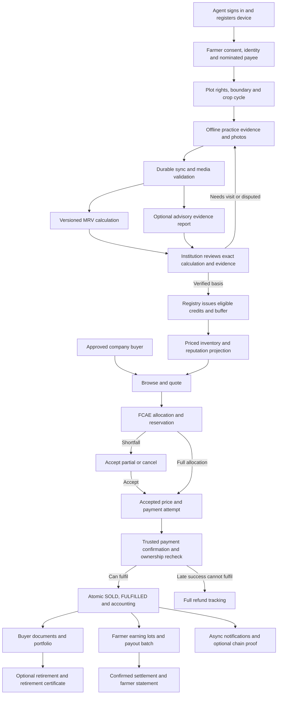

# GreenChain end-to-end application trace

Status: trace of the documented design, not a running application. The folder currently contains specifications and research scripts. This document joins the persona flows, feature contracts, company screens, system design and research workflow into one journey.

When drafts disagree, [system design](15-system-design.md) supplies the engineering baseline; [company journey](14-company-buyer-flow.md) supplies detailed buyer behaviour; [demo plan](13-public-demo-plan.md) determines demo inclusion. Open scientific/business/legal decisions remain open.

## 1. Actors and surfaces

| Actor | Surface | Responsibility |
|---|---|---|
| Farmer | Assisted visits and notifications; agent-provided statements | Consent, rights/practice information and participation; no required farmer smartphone app |
| Field agent | Offline-capable PWA | Onboard, map plots, capture evidence, sync and correct rejected records |
| Institution/verifier | Scoped review web interface | Rights/evidence review, visits, calculation decisions and investigations |
| Company buyer | Company web interface | Browse, accept allocation/prices, pay, track documents and manage owned credits |
| Operations/finance/privacy reviewer | Restricted administration screens | Reconciliation, approved retries, investigation, data requests and recovery |
| Researcher | Isolated datasets/scripts and optional report view | Validate models/methodology and allocation research; no financial/issuance write authority |

Agent and role-based web screens share a static frontend architecture. A modular API processes commands against PostgreSQL; independent workers run durable jobs. Private files live in object storage. Providers are adapters, not sources of frontend business rules.

## 2. Main journey and parallel branches

The farmer-payment and buyer-document branches proceed independently after fulfilment. A document or chain outage does not undo a sale; a sale does not mean that the farmer's bank settlement has already completed.

## 3. Step-by-step trace and document evidence

| Stage | User/system action | Durable result and next gate | Source |
|---|---|---|---|
| 0. Environment preparation | Operator publishes supported configuration and prices; demo seeds scoped roles/data | Versioned settings, complete pricing coverage, private storage and API/worker readiness. No synthetic adapter in production | [F17](features/17-admin-operations.md), [demo](13-public-demo-plan.md) |
| 1. Access | Agent signs in/registers device; staff has a mandate; buyer has approved account/membership | Server session, scoped actor/device and permissions; role cannot be self-selected | [F1](features/01-identity-consent-kyc.md), [company C01–C02](14-company-buyer-flow.md) |
| 2. Farmer onboarding | Agent captures identity/language and purpose/version-specific consent; proposes payee setup | Local draft becomes server identity/consent after accepted sync. Phone, consent and payee verification stay separate; payout remains blocked without required checks | [F1](features/01-identity-consent-kyc.md), [F-A](03-user-flows.md) |
| 3. Land and cycle | Capture boundary, land reference, ownership/cultivation consent and nominated payee; record crop/season/dates | Versioned plot/rights/cycle. Duplicate/overlap or disputed rights require review; plot rights are the payee source | [F2](features/02-land-rights.md) |
| 4. Practice evidence | Capture dated practice claims, required evidence slots and photos, including offline | IndexedDB outbox with stable event IDs; “saved locally” differs from “synced”. Device/GPS/EXIF checks are signals, not proof of truth | [F3](features/03-capture-sync-media.md) |
| 5. Sync/upload | Reconnect; API checks identity/scope/signature/dependencies; upload and validate media | Each accepted event commits receipt, owner changes, audit and jobs. Deferred/rejected/quarantined items remain visible. Required media must validate or receive explicit pre-calculation waiver | [F3](features/03-capture-sync-media.md), [system transactions](15-system-design.md) |
| 6. Calculation/advisory | Worker resolves context, published parameters and compatible cached satellite inputs; optional evidence rules/ML report | Immutable calculation and input/version fingerprint, or NEEDS_VISIT/error. Advisory output may abstain and cannot approve practices, issue credits or change money | [F4](features/04-mrv.md), [MRV](08-mrv-module-design.md), [ML](15-ml-workflow-design.md) |
| 7. Human verification | Mandated reviewer inspects rights, evidence, calculation and any advisory report; approves, requests visit or disputes | Exact reviewed calculation becomes immutable issuance basis with active pointer/generation under cycle lock. Stale calculation requires another review | [F5](features/05-verification.md), [system basis](15-system-design.md) |
| 8. Issuance | Registry job rechecks basis/generation, rights, evidence, freeze/withdrawal and origin | Whole-tonne credits, buffer/carry-over provenance, counters and authoritative eligible aggregates commit together. Replay issues once; unsold issuance produces no farmer earning | [F6](features/06-registry-buffer.md) |
| 9. Reputation/listing | Applicable events update FRPS; market maintains eligible priced inventory | Tier projection is versioned; published prices/tax coverage are required. Buyers see restricted aggregates and freshness, not private farmer records | [F7](features/07-frps.md), [F8](features/08-market-pricing.md) |
| 10. Buyer reservation | Buyer selects one type, vintage/geography filters and quantity; gets informational quote, then places order | FCAE reserves explicit credits under quotas/caps; snapshots prices/taxes/commission and replay inputs. Shortfall/final-price changes need explicit acceptance | [F9](features/09-orders-fcae.md), [company C04–C05](14-company-buyer-flow.md) |
| 11. Payment/fulfilment | Persist attempt before provider call; authenticate callback or reconcile provider result | Successful original allocation commits attempt success, SOLD, FULFILLED, earnings/lots/journal/reserve and jobs in one transaction. Browser redirect is not payment proof | [F10](features/10-payments-refunds.md), [F11](features/11-ledger-payouts.md), [system](15-system-design.md) |
| 12a. Buyer delivery | Workers prepare invoice/receipt and purchase certificate; buyer opens order/portfolio | Immutable document claims and private files; pending/ready/error visible. Ownership is already recorded. Optional proof has separate state | [F12](features/12-certificates-retirement.md), [F13](features/13-chain-audit.md) |
| 12b. Farmer settlement | Daily IST batching selects releasable lots, approved account and applicable legal-gated rules; submits/query rail | One active claim per lot; stable payout identity. Unknown outcome is reconciled before resend. SENT differs from SETTLED; returns require compensation | [F11](features/11-ledger-payouts.md), [payout design](12-payouts-kyc-design.md) |
| 13. Retirement | Buyer separately selects owned eligible credits and reporting purpose/period, if enabled | Exact references rechecked and retired atomically; certificate generated later. Retirement is terminal and separate from purchase | [F12](features/12-certificates-retirement.md), [company C08](14-company-buyer-flow.md) |

Company targets are optional planning context. Company approval does not authorise staff access to another company's orders. A quote does not reserve, payment initiation does not establish ownership, purchase does not retire credits, and retirement does not automatically establish regulatory compliance.

## 4. Trace an individual credit, purchase and payment

The documented provenance path is:

`subject/consent + plot rights → plot/cycle → accepted evidence/validated media → input snapshot + methodology calculation → verifier decision/basis → issued credit → order item + allocation/price snapshot → payment attempt/event → fulfilled sale → earning lot/journal → payout item/attempt/settlement`

Buyer documents branch from the fulfilled order/credit snapshot. Retirement records branch from owned credit references. Optional chain jobs refer to those persisted claims. Identifiers join the facts; they do not grant permission to read them. Carry-over/replacement provenance must retain constituent/original references rather than falsely assigning every tonne to the latest calculation.

Operational questions this chain must answer: Who captured this evidence? Which consent/rights version applied? What exact inputs and parameters produced the estimate? Who reviewed it? Which basis issued the credit? Why did FCAE allocate it? Which prices/commission were accepted? Which provider confirmation paid for it? What was owed to its nominated payee, and did settlement occur?

## 5. Exceptions and ongoing lifecycle

| Event | Required continuation |
|---|---|
| Lost sync acknowledgement | Replay same event ID; return stored outcome without duplicate changes |
| Missing/invalid evidence or unsupported context | Recapture/review/abstain; no invented carbon result |
| Revoked basis before issuance | Stop stale job; reviewed replacement advances generation; no second active basis |
| Expired reservation | Release under authoritative locks; a new order gets fresh availability/prices |
| Pending/unknown payment | Reconcile existing attempt before offering unsafe repeat payment |
| Late successful payment | Reacquire original credits all-or-nothing if still eligible/free; otherwise full refund |
| Second successful payment on fulfilled order | Preserve fulfilment; track separate duplicate-payment refund |
| Certificate, SMS or chain failure | Keep sale/accounting; visibly retry/reconcile downstream job |
| Dispute | Scoped case/investigation; freeze eligible inventory and pause relevant unpaid lots; no automatic fraud finding |
| Confirmed adverse finding | Reviewed reversal/remedy with buffer replacement or refund as policy permits; no new farmer sale from replacement; finance policy gaps remain blockers |
| Multiple cases | Resolving one removes only its hold, not every hold on the credit/lot |
| Access/correction/withdrawal/erasure request | Verify representation; classify retained data; owner workflow/key-generation erasure; completion requires acknowledgements |
| Restore/demo reset | Fence stale writes/jobs; reconcile data/files/keys and external outcomes before reopening |

Sources: [disputes](features/15-disputes-reversal.md), [data rights](features/16-data-rights.md), [operations](features/17-admin-operations.md). Notifications are generated throughout from committed facts, with failed delivery surfaced through tasks rather than rollback: [F14](features/14-notifications.md).

## 6. Research loop outside operational issuance

West Bengal field/study observations → permitted immutable research dataset → context/units/label audit → grouped site/time splits → frozen baselines and satellite/model comparisons → independent errors/uncertainty/subgroup results → specialist review → approved supported-context methodology or advisory release, if justified.

No automatic path goes from training output to live credits. NDVI is contextual vegetation evidence, not direct SOC measurement. Actual SOC monitoring intervals and rice methane/N2O measurements remain distinct. Synthetic demo labels and model-generated carbon values are not independent validation labels. [West Bengal protocol](research/west-bengal-research-protocol.md), [data contract](research/research-data-contract.md), [ML workflow](15-ml-workflow-design.md).

Allocation research separately replays pseudonymous/synthetic inventories and order streams against FCAE/FCFS/reputation comparators with explicit metric definitions. Its reports cannot change operational balances: [E14](features/18-research-evaluation.md).

## 7. Public demo versus production

The first demo traces local capture → durable sync → labelled synthetic calculation → human review → demo issuance → real reservation/accounting logic → simulated payment → buyer certificate plus simulated farmer payout. Public viewers are read-only; presenter state/reset is protected and isolated.

Seeded identities, KYC, carbon inputs, payment/payout rails and notification delivery are simulated as specified in doc 13. Optional chain proof, retirement and dispute paths follow the core slice. Production requires independently supported scientific methodology, real provider contracts/recovery, legal/accounting policy, privacy lifecycle and measured operational readiness. Neither this trace nor a successful demonstration proves those gates have passed.

## 8. Remaining gaps visible in the trace

- Company membership/approval schema, mandatory identifiers and procurement policy are proposed additions, not implemented.
- No verified West Bengal factor release, independent predictive validation or specialist approval exists yet.
- Cross-vintage fractional carry-over provenance and replacement commission/accounting require decisions before those paths ship.
- Live tax, holdback/recovery, retention, support/refund policy and provider arrangements require review.
- No app implementation, concurrency/load tests, hosting readiness or recovery drill can be inferred from specifications alone.

Earlier short flows retain some simplified wording: fixed mandatory GSTIN/CIN/target, generic FROZEN state, and hold extension merely when a payment is in flight. Use the newer contracts: applicable identifiers/optional target; economic state plus case holds; hold extension only on gateway-confirmed PENDING within limits. These distinctions matter when tracing actual implementation.
